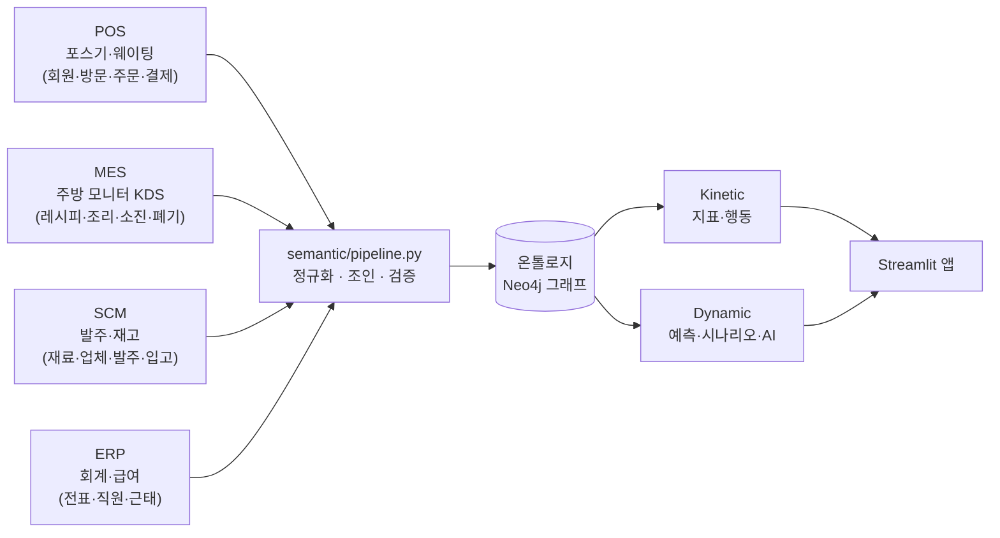
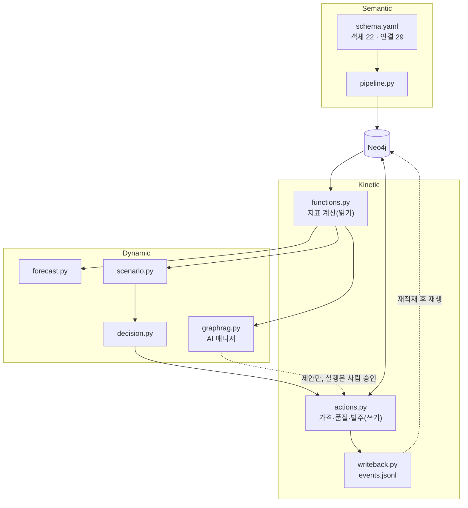

# 한식당 온톨로지 실습 — 팔란티어 방식 + GraphRAG

72석 한식당 **'한솥밥상'**의 3개월(2026-07-01 ~ 09-30) 영업 데이터를 **팔란티어(Palantir) 방식의 온톨로지**로 묶고,
Neo4j 그래프로 시각화한 뒤, 사장님이 의사결정에 쓰는 **Streamlit 웹앱과 AI 매니저(GraphRAG)**까지 만든 실습입니다.

> 모든 데이터는 생성기가 만든 **가상 데이터**입니다. 분석으로 '발견'되는 패턴은 일부러 심어 둔 것이며 목록을 [아래](#심어-둔-패턴)에 공개합니다.

---

## 목차

1. [무엇을 만들었나](#무엇을-만들었나)
2. [핵심 아이디어: 시스템 4개를 하나의 온톨로지로](#핵심-아이디어-시스템-4개를-하나의-온톨로지로)
3. [3개 레이어 구조](#3개-레이어-구조)
4. [온톨로지 설계도](#온톨로지-설계도)
5. [빠른 시작](#빠른-시작)
6. [Neo4j에서 직접 따라가 보기](#neo4j에서-직접-따라가-보기)
7. [레이어별 상세](#레이어별-상세)
8. [사장님 웹앱](#사장님-웹앱)
9. [안전장치](#안전장치)
10. [테스트](#테스트)
11. [가게 규모와 데이터](#가게-규모와-데이터)
12. [폴더 구조](#폴더-구조)
13. [한계와 단순화한 가정](#한계와-단순화한-가정)

---

## 무엇을 만들었나

| 질문 (사장님 입장) | 답하는 곳 |
|---|---|
| 어떤 메뉴를 밀고 어떤 메뉴를 빼야 하나? | 메뉴 엔지니어링 4분면 (Kinetic Function) |
| 테이블이 몇 번 돌고, 어떤 손님을 대기 중에 놓치나? | 회전율·대기 이탈률 |
| 단골·VIP는 누구고, 떠나가는 손님은 누구인가? | 고객 세그먼트 |
| 양파값이 40% 오르면 이번 달 얼마를 더 쓰나? | 원가 충격 시나리오 (Dynamic) |
| 정육 업체를 바꾸면 얼마 아끼나? | 업체 변경 시나리오 |
| 내일 무엇을 얼마나 발주해야 하나? | 수요 예측 → 추천 발주 |
| 가격 바꾸기·품절 처리·발주 넣기 | Kinetic Action (규칙 검증 + 기록) |
| "9월 원가율이 왜 올랐어?" 같은 자연어 질문 | AI 매니저 (GraphRAG, 근거 표시, 실행은 사람 승인) |

**실데이터 예시**: 9월 육류를 대체 업체(대성미트)로 바꿨다면 약 **151만 원 절감**. AI 매니저 답과 손 계산이 일치합니다.

---

## 핵심 아이디어: 시스템 4개를 하나의 온톨로지로

실제 식당에는 서로 모르는 시스템이 여러 개 있습니다. 팔란티어 방식은 **원래 시스템을 고치지 않고**, 그 위에 온톨로지 층을 얹어
"같은 것"을 이어 붙입니다. 각 시스템이 자기 언어를 그대로 쓰고, 가운데에 통역사를 세우는 것과 같습니다.



### 시스템마다 다르게 부르는 것을 맞춘다

생성기는 일부러 시스템마다 형식을 다르게 만들고, 파이프라인이 이를 풀어냅니다.

| 차이 | 예 | 푸는 방법 |
|---|---|---|
| 코드 | 김치찌개: POS `P-101` / MES `R-JJ-KIMCHI` | 메뉴 하나(`menu_id`)로 묶음 |
| 이름 | MES `양파` / SCM `VEG-ONION-1KG` | 대응표 `semantic/mappings/material_map.csv` |
| 단위 | MES g·ml / SCM kg·L | 기준단위(g·ml·ea)로 환산 |
| 코드값 | `M`/`F`, 출생연도, `FAMILY` | 남/여, 연령대, 가족으로 번역 |
| 시각 | `2026-07-01 12:03:00` / `20260701T120300` / `2026/07/01` | 형식 통일 |

### 키와 속성, 그리고 '값으로 잇기'

- **키(key)**: 대상을 하나로 집어내는 고유 번호. 예) 메뉴의 `menu_id`. 겹치지 않고 바뀌지 않습니다.
- **속성(property)**: 대상을 설명하는 값. 예) 메뉴의 `name`, `price`, `is_available`. 바뀔 수 있습니다.
- 시스템을 잇는 방법은 3가지입니다.
  1. **같은 값을 공유** → 바로 연결. 예) ERP 전표의 `source_doc_no` = SCM 발주서 번호
  2. **이름이 다름** → 대응표로 연결. 예) 주방의 "양파" ↔ 구매의 `VEG-ONION-1KG`
  3. **형식이 다름** → 먼저 맞춘 뒤 연결. 예) kg → g

### 시스템을 넘나드는 연결 7종과 계보(lineage)

| 연결 | 뜻 | 조인 규칙 |
|---|---|---|
| `USES` | 메뉴 → 재료 (레시피) | MES 레시피 재료명 → 대응표 → SCM 품목코드 (kg→g 환산) |
| `TRIGGERED` | 주문 → 조리지시 | MES 조리지시의 POS 주문번호 = POS 주문번호 |
| `COOKS` | 조리지시 → 메뉴 | MES 레시피코드 = POS 메뉴의 주방코드 |
| `MOVES` | 재고이동 → 재료 | MES 재료명 → 대응표 → SCM 품목코드 |
| `POSTS_SALES` | 매출전표 → 결제 | ERP `source_doc_no` = POS 일마감 번호 |
| `POSTS_PURCHASE` | 매입전표 → 발주서 | ERP `source_doc_no` = SCM 발주서 번호 |
| `POSTS_COGS` | 원가전표 → 재고이동 | ERP `source_doc_no` = MES 일 소진 마감 번호 |

이 선들에는 **`_rule`**(어떤 규칙으로 이었나)과 **`_join_key`**(실제로 맞춰 본 값)가 붙어 있습니다.
모든 노드에는 **`_system`**(어느 시스템에서 왔나)이 붙어 있습니다. 그래서 "이 둘을 왜 같은 것으로 봤지?"를 언제든 거슬러 확인할 수 있습니다.

**예: 회계 전표만으로는 무엇을 샀는지 모른다**

ERP 전표 `JE-P260722-VEG`에는 금액과 계정만 있습니다. `source_doc_no = PO260722-VEG`를 따라 SCM 발주서로 가야
콩나물 52kg·무 43kg·감자 33kg… 같은 품목이 보입니다. 회계는 **금액**, 구매는 **품목**, 주방은 **사용량**을 알고, 온톨로지가 이를 한 줄로 잇습니다.

---

## 3개 레이어 구조

| 레이어 | 비유 | 폴더 | 내용 |
|---|---|---|---|
| **Semantic** (의미) | 가게의 지도 — 무엇이 있고 어떻게 연결되나 | `semantic/` | 객체·속성·연결 설계도, 원천 → 그래프 적재 파이프라인 |
| **Kinetic** (운동) | 가게의 손발 — 계산하고 행동한다 | `kinetic/` | **Function**(읽기 전용 지표) + **Action**(검증된 쓰기) + write-back |
| **Dynamic** (동적) | 가게의 두뇌 — 내다보고 판단한다 | `dynamic/` | 수요 예측, What-if 시나리오, 의사결정 기록, GraphRAG AI 매니저 |



---

## 온톨로지 설계도

`semantic/schema.yaml`이 **유일한 원본**입니다. 파이프라인 검증, Neo4j 제약조건, AI 매니저의 시스템 프롬프트가 모두 이 파일에서 자동으로 만들어집니다.

### 객체 22종

| 시스템 | 객체 (키) |
|---|---|
| POS | 고객 `Customer`(customer_id), 방문 `Visit`, 대기기록 `WaitingRecord`, 구역 `Zone`, 테이블 `DiningTable`, 주문 `Order`, 결제 `Payment`, 메뉴카테고리 `MenuCategory` |
| POS + MES | 메뉴 `MenuItem`(menu_id) — 가격은 POS, 레시피코드는 MES |
| MES | 조리지시 `CookTicket` |
| MES + SCM | 재고이동 `StockMovement` — 소진·폐기는 MES, 입고·실사는 SCM |
| SCM | 재료 `Ingredient`, 공급업체 `Supplier`, 발주 `PurchaseOrder` |
| ERP | 직원 `Employee`, 근무조 `Shift`, 근태기록 `Attendance`, 계정과목 `Account`, 전표 `JournalEntry` |
| ONTOLOGY | 액션기록 `ActionLog`, 시나리오 `Scenario`, 의사결정 `Decision` — 사람이 온톨로지 위에서 남긴 기록 |

### 고객은 3개 축으로 나눈다

| 축 | 어디에 붙나 | 값 |
|---|---|---|
| 누구인가 | 고객 | 성별, 연령대 — 비회원(약 40%)은 '모름' |
| 누구와 왔나 | **방문** | 혼밥·연인·친구·가족·회식·비즈니스, 인원, 아이 동반 |
| 얼마나 자주 | 계산 결과 | 신규·재방문·단골·VIP·이탈위험 |

같은 사람이 평일엔 혼밥, 주말엔 가족과 옵니다. 그래서 동행유형은 사람이 아니라 방문에 붙입니다.

### 수량은 연결선에 있다

"이 주문에 김치찌개 몇 그릇", "이 메뉴에 양파 몇 g"은 두 대상 사이의 정보이므로 **연결선 속성**입니다.

| 연결 | 수량 속성 |
|---|---|
| 주문 → 메뉴 `CONTAINS` | `qty`(그릇 수), `unit_price` |
| 메뉴 → 재료 `USES` | `qty_per_serving`(1인분 사용량) |
| 발주서 → 재료 `ORDERS_ITEM` | `qty`, `unit_price` |
| 업체 → 재료 `SUPPLIES` | `unit_price`(현재 공급단가), `min_order_qty` |

---

## 빠른 시작

### 준비물

- Python 3.11+
- Docker (Neo4j 5 Community + APOC). Docker 메모리 **4GB 이상 권장**
- OpenAI API 키 (AI 매니저에만 필요)

### 1) 설치

```bash
git clone <이 저장소>
cd <폴더>
python -m venv .venv
.venv/bin/pip install -r requirements.txt
cp .env.example .env        # 비밀번호·API 키 채우기
```

### 2) Neo4j 띄우기

`docker-compose.yml`과 같은 설정입니다. 다른 Neo4j와 겹치지 않도록 **7475(화면) / 7688(접속)** 포트를 씁니다.

```bash
docker run -d --name restaurant-neo4j \
  -p 127.0.0.1:7475:7474 -p 127.0.0.1:7688:7687 \
  -e NEO4J_AUTH="neo4j/<.env의 NEO4J_PASSWORD>" \
  -e NEO4J_PLUGINS='["apoc"]' \
  -e NEO4J_server_memory_heap_initial__size=512M \
  -e NEO4J_server_memory_heap_max__size=768M \
  -e NEO4J_server_memory_pagecache_size=256M \
  -e NEO4J_server_bolt_advertised__address=localhost:7688 \
  -v restaurant_neo4j_data:/data \
  neo4j:5-community

.venv/bin/python db.py      # "Neo4j 5.x 접속 성공 / APOC ..." 이 나오면 OK
```

### 3) 데이터 생성 → 온톨로지 적재

```bash
.venv/bin/python sources/generate.py     # 원천 4개 시스템 CSV → data/raw/{pos,mes,scm,erp}/ (seed 고정, 약 1초)
.venv/bin/python semantic/pipeline.py    # 정규화·조인·검증 → Neo4j 적재 → write-back 재생 (약 30초)
```

### 4) 앱 실행

```bash
.venv/bin/streamlit run app/main.py --server.port 8766    # http://localhost:8766
```

---

## Neo4j에서 직접 따라가 보기

**로그인**: Chrome에서 http://localhost:7475 → Connect URL `bolt://localhost:7688`, 아이디 `neo4j`, 비밀번호는 `.env`의 `NEO4J_PASSWORD`.

> - Connect URL이 7687이면 다른 Neo4j에 붙습니다. 반드시 **7688**.
> - Safari는 암호화되지 않은 로컬 접속을 막아 로그인이 실패할 수 있습니다. Chrome을 쓰세요.
> - 동그라미 이름이 모두 "POS"처럼 보이면, 결과창 위 라벨(예: `Order`)을 눌러 Caption을 `order_id`로 바꾸세요. 연결선도 같은 방법으로 Caption을 `qty`로 바꾸면 수량이 보입니다.

### 예 1. 양파값 인상의 영향 경로 (POS → 메뉴 → 재료 ← SCM)

```cypher
MATCH (m:MenuItem {name:'김치찌개'})-[u:USES]->(i:Ingredient {name:'양파'})
MATCH (po:PurchaseOrder)-[x:ORDERS_ITEM]->(i)
WITH m, u, i, po, x ORDER BY po.ordered_at DESC LIMIT 1
MATCH (o:Order)-[c:CONTAINS]->(m) WHERE o.ordered_at >= localdatetime('2026-09-30T00:00')
RETURN m, u, i, po, x, o, c LIMIT 10
```

> 시각 속성은 시간대가 없는 `localdatetime`으로 저장되어 있습니다. 비교할 때 `datetime(...)`을 쓰면 결과가 비어 나옵니다.

### 예 2. 회계 전표 → 발주서 → 산 재료 (ERP → SCM)

```cypher
MATCH p = (:JournalEntry {je_id:'JE-P260722-VEG'})-[:POSTS_PURCHASE]->(:PurchaseOrder)-[:ORDERS_ITEM]->(:Ingredient)
RETURN p
```

### 예 3. 하루 판매를 표로

```cypher
MATCH (o:Order)-[c:CONTAINS]->(m:MenuItem {name:'김치찌개'})
WHERE o.ordered_at >= localdatetime('2026-09-30T00:00')
RETURN o.order_id AS 주문번호, o.ordered_at AS 시각, c.qty AS 그릇수
ORDER BY 시각
```

`queries.cypher`에 예시가 더 있습니다: ① 양파 → 메뉴 → 매출, ② 전표 → 결제 → 고객, ③ 근태 → 조리시간, ④ 동행유형 → 이탈률, ⑤ 선의 계보(`_rule`, `_join_key`).

---

## 레이어별 상세

### Semantic — `semantic/`

| 파일 | 하는 일 |
|---|---|
| `profile.yaml` | 확정한 가게 규모 (테이블·메뉴·재료·업체·직원·근무조, 영업시간, 휴무일) |
| `schema.yaml` | 설계도: 객체 22종, 연결 29종, 객체를 뒷받침하는 시스템, 시스템 간 조인 규칙 |
| `schema.py` | 설계도 모순 검사, Neo4j 고유 제약조건 적용 |
| `pipeline.py` | `build`(정규화·조인) → `conform`(설계도 대비 검증) → `load`(적재) → write-back 재생 |
| `mappings/material_map.csv` | 주방 재료명 ↔ SCM 품목코드 대응표 (온톨로지 팀이 관리하는 파일) |

`sources/master.yaml`은 가게의 '진짜' 기준정보이고, 생성기만 읽습니다. **파이프라인은 이 파일을 보지 않습니다.** 원천 CSV만으로 다시 맞춰 내는 것이 실습의 핵심입니다.

### Kinetic Function — 읽기 전용 지표 (`kinetic/functions.py`)

| 함수 | 답하는 질문 | 계산 방법 |
|---|---|---|
| `menu_costs(as_of)` | 메뉴 하나 팔면 얼마 남나? | 레시피 사용량 × 기준일까지 가장 최근 매입단가 ('요청'·'취소' 발주 제외) |
| `menu_engineering(start, end)` | 어떤 메뉴를 밀고 뺄까? | Kasavana–Smith 4분면: 인기(판매비중 ≥ 0.7 ÷ 메뉴 수) × 마진(≥ 판매 가중평균) → Star·Plowhorse·Puzzle·Dog (주류·음료 제외) |
| `table_turnover(start, end)` | 테이블이 몇 번 돌았나? | 날짜·점심/저녁별 착석 팀 ÷ 테이블 수, 착석 인원 ÷ 좌석 수 |
| `waiting_stats(start, end)` | 누구를 놓치나? | 동행유형별 대기 이탈률, 착석 팀 평균 대기시간 |
| `monthly_cost_ratio()` | 원가율이 오르나? | ERP 전표: 식재료비 차변 ÷ 수익 계정 대변 |
| `usage_variance(start, end)` | 레시피보다 더 쓰나, 얼마나 버리나? | 조리지시 기준 레시피량 vs 실제 소진, 폐기 ÷ 전체 사용(반찬 포함) |
| `stock_status(as_of)` | 무엇이 곧 떨어지나? | 재고이동 합계, 최근 7일 하루 평균 사용, 소진 예상일, 안전재고 미달 |
| `customer_segments(as_of)` | 단골·VIP·이탈위험은 누구? | 아래 규칙 (착석한 방문만 셈) |

고객 세그먼트 규칙 (위에서부터 우선):
**이탈위험** 마지막 방문 시점엔 단골이었는데 30일 이상 미방문 → **단골** 최근 90일 4회 이상 + 마지막 방문 30일 이내 →
**VIP** 단골 중 1회 평균 결제액 상위 20% → **재방문** 누적 2회 이상 → **신규** 1회.

### Kinetic Action — 데이터를 바꾸는 행동 (`kinetic/actions.py`)

| 액션 | 거부 규칙 | 실행하면 |
|---|---|---|
| `change_price` 가격 변경 | 새 가격 ≤ 원가, 한 번에 ±30% 초과 | `MenuItem.price` 변경 |
| `set_availability` 품절·판매 재개 | 이미 그 상태 | `MenuItem.is_available` 변경 |
| `create_purchase_order` 발주 | 그 업체가 안 파는 재료, 수량 ≤ 0, 합계 300만 원 초과 | `PurchaseOrder`(요청) + 품목 + 업체 연결 |

- 실행·거부 모두 `ActionLog` 노드로 남고 대상과 연결됩니다 (감사 추적).
- **write-back**: 액션·시나리오·결정은 `data/writeback/events.jsonl`에도 한 줄씩 쌓입니다. 원천에서 다시 적재하면
  마지막에 이 기록을 같은 id·시각으로 재생해 그대로 복원합니다 (팔란티어의 write-back 데이터셋 개념).

### Dynamic — 예측·시나리오·의사결정·AI (`dynamic/`)

| 파일 | 내용 |
|---|---|
| `forecast.py` | 같은 요일 최근 N주 평균으로 메뉴 수요 예측 → 레시피로 재료 필요량 → 추천 발주량 = 필요 + 안전재고 − 재고 − 입고 예정, 최저가 업체 |
| `scenario.py` | **원가 충격**: 재료 단가 ±% → 메뉴별 새 원가·마진·기간 영향액. **업체 변경**: (새 공급단가 − 현재 매입단가) × 기간 사용량 |
| `decision.py` | 결정 기록 `Decision` —근거→ `Scenario`, —실행→ `ActionLog`. 결정 추적, 기준일 전후 판매 비교 |
| `graphrag.py` | AI 매니저: OpenAI 함수호출 (기본 `gpt-4.1-mini`, `OPENAI_MODEL`로 변경) |

**원가 충격 검산 예** (양파 +40%, 9월, 김치찌개):

| 단계 | 값 | 출처 |
|---|---|---|
| 1인분 양파 | 30g | MES 레시피 (`USES.qty_per_serving`) |
| 최근 매입단가 | 4.2원/g | SCM 발주서 (`ORDERS_ITEM.unit_price`) |
| 1인분 추가 원가 | 30 × 4.2 × 0.4 = 50.4원 | 계산 |
| 9월 판매 | 736그릇 (26영업일) | POS 주문 (`CONTAINS.qty`) |
| 영향액 | 50.4 × 736 = **37,094원** | 앱 화면 값과 일치 |

계산 코드는 별도 파일을 읽지 않고 그래프의 연결선만 따라갑니다. 연결이 끊긴 메뉴·재료는 계산에 잡히지 않습니다.

**AI 매니저 원칙**

- 숫자는 **도구 결과에서만** 가져옵니다 (Function·예측·시나리오·읽기 전용 Cypher).
- 답과 함께 **근거**(호출한 도구·인자·결과)를 펼쳐 볼 수 있습니다.
- 가격·품절·발주는 **제안만** 하고, 실행은 화면의 승인 버튼으로 사람이 합니다.
- 시스템 프롬프트는 `schema.yaml`과 DB 기준정보(업체별 공급 재료·메뉴 id·가격)로 자동 생성됩니다.
- 도구 호출은 최대 6단계, Cypher 결과는 최대 50행, 15초 제한.

---

## 사장님 웹앱

```bash
.venv/bin/streamlit run app/main.py --server.port 8766
```

| 메뉴 | 레이어 | 내용 |
|---|---|---|
| 개요 | - | 월 매출·원가율·회전율·놓친 팀·이탈위험, 재고 경보, 지금 볼 것 |
| 온톨로지 탐색 | Semantic | 설계도 그래프 (색 = 원천 시스템), 객체 한 건의 주변 그래프 (선에 마우스 → 계보), 시스템별 데이터 양 |
| 운영 현황 | Kinetic Function | 메뉴 엔지니어링 4분면, 회전율 히트맵, 이탈률, 원가율, 로스·재고, 고객 세그먼트 |
| 액션 | Kinetic Action | 가격·품절·발주 실행 (검증 메시지), 실행 기록 |
| 예측·시뮬레이션 | Dynamic | 수요 예측과 추천 발주, 원가 충격, 업체 변경, 의사결정 기록, 전후 비교 |
| AI 매니저 | Dynamic | 채팅 + 근거 펼쳐 보기 + 제안 승인 실행 |

- 사이드바의 **기준일**로 모든 화면의 '오늘'을 바꿀 수 있습니다.
- 원천 시스템 색은 고정입니다: POS 파랑 · MES 주황 · SCM 초록 · ERP 노랑 · ONTOLOGY 분홍 (다크 화면에서 색각 이상·대비 검사 통과 팔레트).

---

## 안전장치

독립 검수(아키텍처·보안·코드 품질)에서 지적된 내용을 반영했습니다. 모두 회귀 테스트가 있습니다.

| 위험 | 막는 방법 |
|---|---|
| AI 제안에 예산·기록 위치 같은 내부 옵션을 끼워 넣기 | 액션별 허용 인자만 실행 (`check_proposal`), 내부 옵션은 키워드 전용 |
| NaN·문자열·참/거짓을 숫자 자리에 넣어 검증 통과 | 0보다 큰 유한한 숫자만 허용, AI 인자의 NaN·Infinity는 읽는 단계에서 거부 |
| 승인 화면이 실제 실행 내용과 다름 | 서버가 계산한 미리보기 (메뉴명·현재가→새 가격, 발주 업체·품목·합계), HTML 이스케이프 |
| Cypher로 쓰기·외부 접속 우회 (백틱, 주석, `LOAD CSV`, 프로시저) | 원문 그대로 검사: 쓰기 키워드 + 백틱·`CALL`·`apoc`·`dbms`·주석·`LOAD` 금지, 그리고 **읽기 전용 트랜잭션** |
| 검증한 뒤 다른 곳에서 값이 바뀜 | 조건부 쓰기 (이전 값일 때만 변경), 어긋나면 거부로 기록 |
| 재적재 후 재생 결과가 원래와 다름 | write-back에 원래 판정·예산 저장, 다르면 경고. 실패한 건은 경고 후 건너뛰고 나머지는 계속 복원 |
| 데이터 밖 날짜를 '판매 0'으로 계산 | 예측·전후 비교 모두 데이터 기간 (7/1~9/30) 안으로 제한 |
| 비밀키 노출 | `.env`에서만 읽고 git 제외, 앱 오류 화면에는 예외 종류만 표시 |

---

## 테스트

**손으로 정답을 계산할 수 있는 작은 가게**(`tests/conftest.py`의 `tiny_store`: 테이블 2개, 메뉴 5개, 재료 4개)를 별도 Neo4j에 넣고,
함수 결과를 손 계산과 비교합니다. 실데이터 DB를 지우지 않도록 테스트 DB는 **7689 포트일 때만** 동작합니다.

| 파일 | 대상 DB | 확인하는 것 |
|---|---|---|
| `test_schema.py`, `test_pipeline.py` | 본 Neo4j (7688) | 설계도·파이프라인·계보·적재 |
| `test_functions.py` | 테스트 Neo4j (7689) | 각 지표 함수의 정답 (TDD) |
| `test_kinetic_acceptance.py` | 본 Neo4j | 실데이터에서 심어 둔 패턴이 잡히는지 |
| `test_actions.py`, `test_dynamic.py` | 테스트 Neo4j | 액션 검증·기록·write-back 재생, 예측·시나리오·결정 |
| `test_graphrag.py` | 테스트 Neo4j | 가짜 LLM으로 에이전트 루프·제안·오류, 읽기 전용 안전장치 (실호출 1개는 `RUN_LIVE_LLM=1`) |
| `test_app.py` | 본 Neo4j | Streamlit AppTest로 6개 화면 렌더 |

최근 결과: 테스트 DB 67 passed (1 skipped: 실제 OpenAI 호출), 본 DB 58 passed (실제 OpenAI 호출 포함).

```bash
# 테스트 전용 Neo4j 최초 1회 생성 (저장소 없음, 끄면 데이터 사라짐)
docker run -d --name restaurant-neo4j-test -p 127.0.0.1:7689:7687 -e NEO4J_AUTH="neo4j/<.env의 비밀번호>" \
  -e NEO4J_server_memory_heap_max__size=384M -e NEO4J_server_memory_pagecache_size=64M neo4j:5-community

# Docker 메모리가 2GB 이하면 두 Neo4j를 동시에 못 띄웁니다 → 번갈아 실행
docker stop restaurant-neo4j && docker start restaurant-neo4j-test
.venv/bin/python -m pytest -q tests/test_functions.py tests/test_actions.py tests/test_dynamic.py tests/test_graphrag.py
docker stop restaurant-neo4j-test && docker start restaurant-neo4j
RUN_LIVE_LLM=1 .venv/bin/python -m pytest -q tests        # 나머지 (테스트 DB용은 자동으로 건너뜀)
```

---

## 가게 규모와 데이터

| 항목 | 값 |
|---|---|
| 기간 | 2026-07-01 ~ 09-30, 월요일 휴무 |
| 영업시간 | 점심 11:00~15:00, 저녁 17:00~22:00 |
| 좌석 | 테이블 18개 · 72석 (룸 4개) |
| 메뉴 | 24개, 7개 카테고리 |
| 재료 | 40종 |
| 공급업체 | 6곳 — 채소 `VEG`, 정육 A `MEAT-A`(주거래), 정육 B `MEAT-B`(대체: 8% 저렴, 리드타임 2일), 수산 `SEA`, 건어물·식자재 `DRY`, 주류 `LIQ` |
| 직원 | 10명, 근무조 3개 (오픈·마감·피크보강) |
| 회원 | 1,500명, 방문의 약 40%는 비회원 |

발주서 번호 `PO260722-VEG` = 2026-07-22 채소 업체 발주, 매입 전표 번호 `JE-P260722-VEG`는 그 발주에 대한 전표입니다.

### 심어 둔 패턴

가상 데이터이므로 실제 경영 인사이트로 착각하지 않도록 공개합니다. 상세 수치는 `sources/generate.py` 상단에 있습니다.

1. 동행유형 비율이 평일/주말·점심/저녁마다 다름 (금요일 저녁 회식↑, 주말 가족↑)
2. 체류시간: 회식(약 110분) > 가족 > 연인 > 친구 > 비즈니스 > 혼밥
3. 점심 손님은 덜 기다림 → 대기 이탈
4. 동행유형별 메뉴 취향 (가족→불고기·갈비탕, 회식→보쌈·파전+술)
5. 술: 회식 1인당 1.8병
6. 계절: 냉면·국수는 7~8월↑ 9월↓, 갈비탕·순두부는 반대
7. 단가 인상: 양파 +40%(9/1), 돼지앞다리 +15%(8/15), 배추 +60%(8/10) → 9월 원가율 상승
8. 충성 회원 일부가 8/25 이후 발길을 끊음 (이탈 단골)
9. 주방 인원 부족 → 조리시간 증가 (화·수 점심, 목 저녁)
10. 홀 아르바이트가 적은 평일 → 테이블 정리 지연
11. 레시피보다 평균 3% 더 씀, 저녁 제육·불고기는 8%
12. 유통기한 4일 이하 재료(상추·콩나물·소불고기·바지락) 폐기율이 높음 (약 7~8%, 나머지 냉장 채소 1~4%)
13. (결과로 생긴 패턴) 룸이 4개뿐이라 회식 손님 이탈률이 약 37%

---

## 폴더 구조

```
.
├── semantic/            # Semantic: 설계도·파이프라인
│   ├── profile.yaml     #   가게 규모
│   ├── schema.yaml      #   객체·연결·조인 규칙 (유일한 원본)
│   ├── schema.py        #   설계도 검사·제약조건
│   ├── pipeline.py      #   원천 → 정규화·조인 → Neo4j
│   └── mappings/        #   재료명 대응표
├── kinetic/             # Kinetic: 지표(Function)·행동(Action)·write-back
├── dynamic/             # Dynamic: 예측·시나리오·의사결정·GraphRAG
├── app/                 # Streamlit 앱 (main.py, common.py, views/)
├── sources/             # 가상 원천 데이터 생성기 (master.yaml, generate.py)
├── tests/               # pytest (작은 가게 픽스처 + 실데이터 수용 테스트 + AppTest)
├── data/                # (git 제외) raw CSV, writeback/events.jsonl
├── queries.cypher       # Neo4j 브라우저용 예시 질문
├── db.py                # Neo4j 접속 (.env)
├── docker-compose.yml   # Neo4j 설정 참고용
└── .env.example         # 환경변수 예시
```

---

## 한계와 단순화한 가정

**한계**

- 로컬 실습용이라 Neo4j 계정이 하나(관리자)입니다. 운영 환경이라면 AI용 읽기 전용 계정과 `dbms.security.procedures.allowlist` 설정을 추가해야 합니다.
- `requirements.txt`는 최소 버전만 지정합니다 (고정 버전 아님).
- 그래프 시각화 스크립트(vis-network)를 CDN에서 불러옵니다.

**가정**

- 부가세, 4대보험, 주휴수당, 카드수수료는 생략
- 재고가 바닥나는 상황(품절)은 일어나지 않게 발주 정책을 넉넉히 잡음
- 원가는 '최근 매입단가 × 사용량' (이동평균 등 원가흐름 가정 미적용)
- 테이블 합석·붙이기 없음
